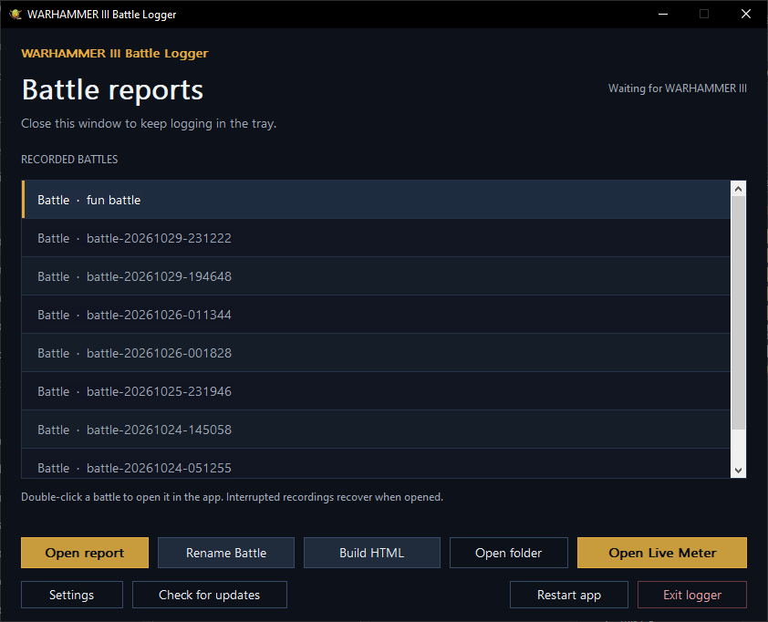
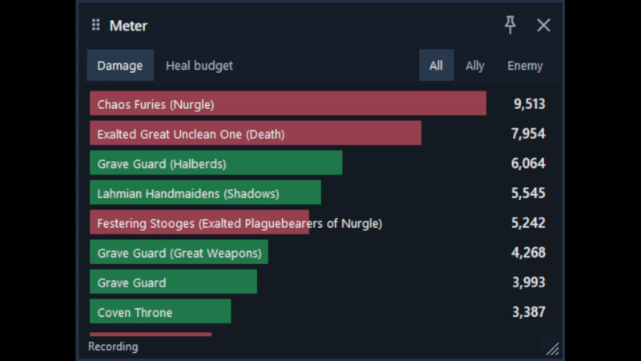
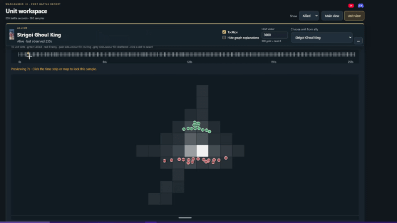

  
  
  
  

  

# WARHAMMER III Battle Logger

See where your army made the difference.

Automatically record battles, follow live damage, and explore what happened afterward—all in one desktop app.

[View an example battle report](https://examplebattle.yutaohi.workers.dev/)

- **Live damage meter:** choose all, allied or enemy units and switch between damage dealt and healing budget. Green allied bars, red enemy bars and clear text on a solid background, with optional always-on-top. Enemies appear only after being spotted.
- **Detailed battle reports:** damage breakdowns, gold damage, kills, healing estimates, ammunition and Winds of Magic.
- **Track changes over time:** inspect unit statlines, buffs and debuffs, leadership and fatigue.
- **Interactive battlefield maps:** follow every unit and see where damage, healing and other stats were generated.
- **Share your battles:** rename recordings and export standalone HTML reports, with no account or upload required.
- **Quiet background recording:** close the menu and keep logging in the tray. Silent notices mark battle detection and completion.

## Get started

1. Download the latest app from [latest release](https://github.com/Americanyutao/Warhammer-Post-Battle-Logger/releases/latest) and extract the full folder.
2. Run **WH3BattleLogger.exe** before entering a battle, then play normally.
3. Double-click a battle in the main menu to open its report.

Download **WH3BattleLogger-Windows-x64.zip** under release **Assets**, rather than the Source code archives.

Close the menu with **X** to keep recording. Double-click the tray icon to reopen it; choose **Exit logger** to stop. Use **Check for updates** for future releases.

## Make it yours

**Open Live Meter** opens the overlay; the same button becomes **Hide Live Meter**. Choose **Damage / Heal budget** and **All / Ally / Enemy**. Bars and rankings animate smoothly over your sampling interval. Click a bar to switch stats. Drag the header, resize from an edge or corner, and reopen with your size, position and filters restored.

The **pin** keeps the meter on top and starts off. The meter has its own taskbar preview, stays open when the menu is closed, and can be reopened with **Show meter** in the tray. Departed units stay grey in Damage and leave Heal budget.

**Settings** controls one sample every **1–5 seconds** and report icons. Saving never opens the meter. Interval changes apply to the next battle.

Choose allied, enemy or all units in reports. Select a unit for detailed charts, pop graphs into separate windows, and rename battles directly from the menu. **Build HTML** saves a shareable report in **captures/shareables** without opening a folder.

## Screenshots

Open and rename battles, build shareable HTML reports, and launch the live meter from the main menu.

Follow damage dealt and remaining healing budgets in the live meter.

Track unit movement and see where battlefield statistics were generated.

Compare unit performance in the battle overview, including damage, gold damage, damage taken, status, HP and models.

Explore healing received and the remaining healing budget for each unit.

Select different statistics in the unit graphs to inspect how a battle unfolded.

Follow fatigue points over time against fatigue-state thresholds.

Compare friendly fire across units.

## Keep your recordings

Recordings are encrypted and saved locally in **captures**. Keep **logger.key** with them—you need it to open your battles. Reports work offline, and HTML export is optional. Interrupted recordings can recover saved samples; missing readings and unconfirmed results stay unknown.

Windows app. Reads supported game builds without modifying the game.

[YouTube](https://www.youtube.com/@Americanyutao) · [Discord & support](https://discord.com/invite/v27y7AW7Kz)

Report bugs through [Discord](https://discord.gg/v27y7AW7Kz) @Americanyutao.
