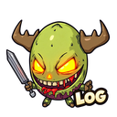
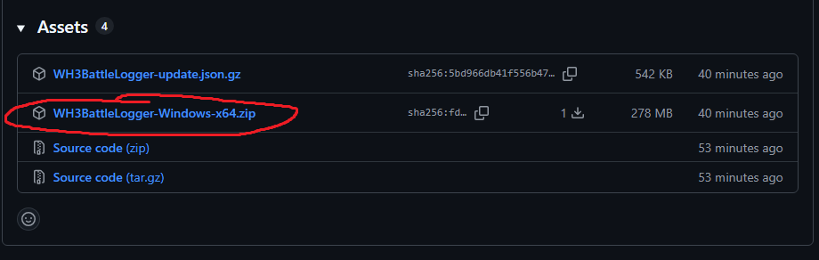
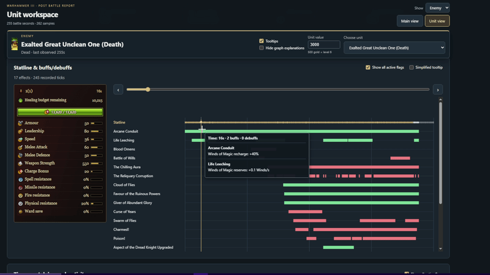

<p align="center">
  <a href="https://www.patreon.com/c/Americanyutao">
    
  </a>
  <a href="https://www.youtube.com/@Americanyutao">
    
  </a>
  <a href="https://www.twitch.tv/americanyutao">
    
  </a>
  <a href="https://discord.com/invite/v27y7AW7Kz">
    
  </a>
</p>
<p align="center">
  
</p>

# WARHAMMER III Full Battle Details

An external battle logger for **Total War: WARHAMMER III**. It records quietly in the Windows notification tray and displays interactive battle reports inside the app.

Compare unit performance, explore damage breakdowns, and inspect graphs of health, leadership, fatigue, movement and Winds of Magic.

[View an example battle report](https://examplebattle.yutaohi.workers.dev/)

## Download and run

1. Open the [latest release](https://github.com/Americanyutao/Warhammer-Post-Battle-Logger/releases/latest).
2. Under **Assets**, download **WH3BattleLogger-Windows-x64.zip**, circled below. Do not download the **Source code** archives.
3. Right-click the ZIP and choose **Extract All**. Extract it into a folder you can write to.
4. Open the extracted folder and run **WH3BattleLogger.exe**. Keep the **_internal** folder beside the executable.
5. Start the logger before your battle and leave it running through the results screen.



**Do not download WH3BattleLogger-update.json.gz manually.** The app reads this small update index automatically to find and download future updates.

The main menu lists encrypted **.wh3log** recordings. **Rename Battle**, to the right of Open report, changes a closed battle's filename and report title while retaining saved values and corrections. New recordings use date/time names, with `(1)`, `(2)` and so on for duplicates. Older random filename suffixes are removed on executable startup. Double-click a battle to open it in a separate app window with the same tables, charts, timelines and graph popouts. No HTML is generated automatically. Images and skill information come from the bundled app files.

The report window opens first, then loads battle data followed by shared icons and skill details. Its temporary viewer cache is removed when the window closes; stale caches from a crash are cleaned on the next launch. Graph choices and manually entered unit values are saved separately. Interrupted recordings recover authenticated saved samples when opened, with missing data marked explicitly. **Export HTML** saves a standalone report in **captures/shareables** beside the executable, using the recording's filename with `.html` instead of `.wh3log`, and opens that folder in File Explorer when finished. Re-exporting refreshes the matching HTML.

A separate **What's new in vX.X.X** window appears when launching the executable, showing a short summary of that installed version's GitHub release notes and a link to the full notes. Previously fetched notes remain available offline. Close the main menu with **X** to keep logging in the Windows notification tray. Double-click the tray icon to reopen the menu; reopening does not show the welcome window again.

Right-click the tray icon:

- **Main menu / reports** opens the report menu.
- **Restart app** saves the current recording and restarts the logger.
- **Check for updates** checks GitHub for a newer stable version and offers to download and install it. Available in v1.1.0 and later.
- **About** shows the installed version and opens its GitHub release notes.
- **Exit** finishes saving the current recording and closes the logger and its viewer windows.

Starting after deployment asks whether to continue logging the battle; choosing **No** discards it. Choosing **Yes** marks its report with a warning about incomplete or incorrect values. Game exits or 30 seconds without readable unit data automatically seal the recording. Pausing while unit data remains readable keeps recording. After a computer crash, relaunch the app and open the recording to recover saved samples; the final samples may be missing, and missing results stay unknown.

The packaged application does not require Python. It requires **64-bit Windows**, **Microsoft Edge WebView2 Runtime** for the embedded viewer, and a supported build of **Total War: WARHAMMER III**. Game updates may require an updated logger.

Report images use battle-bar unit cards, including character cards stored under `portraits/units`. Porthole and minspec-porthole images are excluded. Recorded character portraits select the exact appearance; older captures without that information may use a labeled default appearance.

## Updating (v1.1.0 and later)

The executable checks for a newer stable GitHub release in the background at each launch. When one is available, a **New version available — Download now?** dialog appears after other open dialogs. **Yes** downloads it; **No** keeps the current version running. Offline or up-to-date launches show no update alert. You can also choose **Check for updates** from the main menu or tray. Installation still requires confirmation.

From v1.1.2 onward, the logger checks which application files changed and downloads only those portions of the release ZIP. The confirmation shows the actual download size. In v2.0.0, an Explorer-style progress window shows the percentage, transferred/installed MB, speed, estimated time remaining and current file. Pause/resume and Cancel are available during transfer and installation; cancelling installation restores and restarts the previous version. Recording continues during the download. The logger verifies each downloaded file and tests the new application, then asks before saving, closing, installing and restarting. **Install updates between battles** so your recording is not interrupted.

Your **.wh3log recordings** and **logger.key** stay in place. Manual update checks and completed updates remove old HTML exports from captures. Successful updates keep one installed copy: temporary replacement files are removed, and backups created by older logger versions are cleaned up. Temporary copies of changed files are used only during installation to recover from a failed copy.

**Coming from v1.1.0 or v1.1.1:** one full download is needed to obtain the new updater. Smaller downloads and download progress are available for subsequent updates. Large downloads are still possible when many files, game images or runtime dependencies change.

**Upgrading from v1.0.0:** download v1.1.0 or a later release manually using the steps above. Exit the old logger first. Keep your existing **captures** folder, including **logger.key**; if you extract the new app into a separate folder, copy the captures folder beside the new executable. After this upgrade, future updates can be installed from the tray menu.

## What the reports show

- **Battle overview:** victory or defeat, with the result classification when captured.
- **Unit comparisons:** damage dealt, gold damage, kills, friendly fire, self damage, calculated damage taken, calculated healing received, HP and models.
- **Damage breakdowns:** Direct damage, Melee, Missiles and Other, with separate enemy, friendly-fire and self-damage HP totals. Hover column headings for short explanations.
- **Ranged statistics:** initial primary and secondary ammunition and the net decrease in each ammunition pool.
- **Unit graphs:** health, models, damage, ammunition, fatigue state and points, leadership, healing information and elevation.
- **Movement and occupancy:** sampled paths and time spent in different areas, using a shared map frame for the battle.
- **Winds of Magic:** usable winds and reserves over time.
- **Unit statline:** scrub the shared Statline/effect timeline to inspect current HP, models, armour, leadership, speed, melee attack/defence, weapon strength, charge bonus and resistances in a unit-card panel. Each recording tick retains its full snapshot, including temporary stat changes. Fire resistance and weakness stay separate; missing values show a dash. Older captures cannot recover these newly recorded stats.
- **Buffs and debuffs:** a timeline below Winds in each unit's workspace, with separate rows for observed effect instances, including same-name spells and bound spells. Bars connect consecutive detections. Hover a name or bar for listed effects only: stat modifiers, healing and damage rates from the game files. Rates follow recorded intensity and battle scaling; they are configured values, not measured damage or healing. Captures without those readings show marked base values. The full exported ability/phase reference is bundled for offline lookup; unnamed or unknown effects get readable labels instead of raw game IDs. Green indicates buffs, red debuffs and gold other effects.
- **Activity:** time spent in observed activities and states, idle time after rallying, and sampled rally and landing counts.

Choose allied, enemy or all units. Unit graphs can also be opened in separate mini windows, with up to four pop-outs.

## How recording works

The logger reads supported game data from the running game's memory without modifying it. It is an external application rather than a Steam Workshop mod.

Sampling defaults to once per second. Deployment supplies initial unit values, while combat timelines begin when the battle starts. Duration measurements use battle simulation time, so pauses and speed changes do not count as normal-speed elapsed time.

New captures use the battle countdown, with deployment providing the initial reading. A 60-minute timer at 59 minutes remaining corresponds to 60 elapsed seconds. Displayed times round to the nearest whole second; fractional timestamps are retained for correct spacing. Earlier captures use the saved deployment clock as an estimate when available.

Timeline positions use the in-game clock: at 4× speed, readings taken one real second apart appear about four battle seconds apart. Paused readings share one timestamp. Buff/debuff bars assume an effect stayed active between consecutive detections. An absent or unreadable tick, or a known recording gap, breaks the bar. Brief effects between readings can still be missed. Internal effects hidden from the game's UI may not appear. Older captures do not contain this new effect data.

Encrypted recordings are saved in **captures**, and HTML exports in **captures/shareables**, beside the application:

- **.html:** an optional standalone export in **captures/shareables**, with the same battle name as its recording. **Check for updates deletes legacy HTML exports from captures**; new recordings do not generate HTML automatically.
- **.wh3log:** a losslessly compressed, encrypted battle recording. Zstandard compression runs before encryption with a bounded history and per-record authentication. Every saved sample is retained; approved floating-point fields use the precision policy described below. Startup optimizes older complete release recordings in the background, verifies the expected transformed records and replaces each file atomically. In-use, incomplete or unreadable files stay unchanged. Both old and new formats remain readable.
- **logger.key:** the private key needed to read your encrypted recordings. Keep it with recordings you want to reopen.

## Interpreting the statistics

Some statistics are sampled observations or calculations rather than complete event histories. Events between samples may be missed.

- **Ammunition:** compares beginning and ending ammunition. Replenishment is not accounted for separately, and dead models take their remaining ammunition with them. The decrease is not a verified count of projectiles fired.
- **Healing and damage taken:** estimates using starting HP and the recorded healing allowance, including units that enter battle wounded. Deployment provides the baseline when captured. Mid-battle capacity changes, transformations and healing outside the normal budget can distort these estimates. Remaining healing allowance is read directly from the game.
- **Damage categories:** follow the game's recorded source categories. Some spells, including vortex effects, can appear under Missiles. Gold damage currently has an enemy total only; gold by damage type and friendly-fire gold are unavailable.
- **Lords and heroes:** the default unit value is 500 gold per level. Treat trade comparisons using that value as estimates.
- **Movement, rallies and landings:** derived from sampled positions and state changes.
- **Barrier statistics:** remain work in progress.

Move along the **Statline & buffs/debuffs** timeline to inspect a unit's stats and active effects at each recorded moment. Green stat changes show gains from the initial statline; red changes show losses.



## Screenshots

Compare unit performance in the battle overview, including damage, gold damage, damage taken, status, HP and models.


Explore healing received and the remaining healing budget for each unit.


Select different statistics in the unit graphs to inspect how a battle unfolded.


Follow fatigue points over time against fatigue-state thresholds.


Compare friendly fire across units.


## Build from source

Use Python 3.13 on 64-bit Windows:

```powershell
python -m pip install -r requirements-build.txt
python -B tools/test_ci.py
python -B tools/build_release.py
python -B tools/check_release.py --headless
python -B tools/package_update.py
```

The application is built into `release/WH3BattleLogger/`. Keep the complete folder together. Run `python -B tools/check_release.py` in a normal Windows desktop session for the additional tray checks. `Run-Battle-Logger.cmd` opens the source debugging interface.

GitHub Actions builds and tests on pushes, pull requests and manual runs. Pushing a version tag also prepares a **draft GitHub Release** with the tested application ZIP and update manifest already attached. Nothing becomes public until you publish the draft.

To release an update:

1. Increase `src/version.py`, then commit and push the finished changes, including the workflow.
2. In GitHub Desktop, open **History**, right-click that commit, and choose **Create Tag**. Enter the matching unused version, such as `v2.0.0`, then **Push origin**.
3. Wait for **Build Windows app** and **Prepare draft release** to succeed in Actions.
4. Open the draft under **Releases**, review the two attached files and release notes, then publish as the latest stable release.

If a tag was pushed before this automation existed, commit/push the workflow to main, then open **Actions > Build Windows app > Run workflow**, select **main**, enter the existing tag (for example `v1.1.2`) in **release_tag**, and run it. This builds that exact tag and prepares its draft without moving or recreating the tag. Leave release_tag blank for a build-only manual run.

Tags must match the app version exactly. Published releases are never overwritten; use a new version for the next release. Rerunning a failed tag build can refresh its draft assets while preserving your release notes. No personal access token or manual upload is needed.

For a manual release, download and extract the **WH3BattleLogger-release-files** Actions artifact and attach the two files inside it. Do not attach the outer artifact ZIP.


For each public update, increase `src/version.py` and use the matching `vMAJOR.MINOR.PATCH` release tag (for example, `2.0.0` in the source and `v2.0.0` on GitHub). After building, `tools/package_update.py` produces these two files in `build/publish/`:

- **`WH3BattleLogger-Windows-x64.zip`** — the complete, clean app for new users and older updaters.
- **`WH3BattleLogger-update.json.gz`** — the compressed inventory of version, file sizes, checksums and byte locations used for smaller updates.

Always attach both files from the **same build**, with these exact names. The ZIP is generated from app-owned files only, excluding captures, keys, logs and backup folders. Do not recompress or change the ZIP afterward: the manifest describes the exact generated bytes.

Publish as the latest stable release; drafts and prereleases are not offered. The updater verifies GitHub's manifest checksum, verifies each changed file against that manifest, and checks that the packaged version matches the release tag. Missing metadata or a server that cannot supply partial downloads produces an error rather than silently downloading the full app. Publish a new version rather than replacing a package under an existing version. Pushing source alone does not distribute an app update. No GitHub token is bundled or required.

## Feedback

Report bugs through [Discord](https://discord.gg/v27y7AW7Kz) @Americanyutao

Release recordings use field-specific decimal precision: generally four decimals, three for the millisecond model clock, exact integer counters, and full precision for raw regeneration, effect intensity/damage scale and legacy healing-ceiling calculation inputs. CPU, memory, read-time and other debug performance data are excluded from release logs and reports. Debug mode retains its diagnostics.

The movement/occupancy map includes all units, combines both sides into white intensity shading, uses green dots for allies and red dots for enemies, and names units when their dots are hovered. Click its time strip or map to lock the selected sample; click again to unlock. This lock does not freeze the other charts. Only recorded positions are shown.

Movement dots grow gently with map zoom. Initials omit parenthesized text and articles/connectors and remain visible even where dots overlap. Click a dot to select its unit. Routing dots use white-green allied or white-red enemy fills; shattered dots use grey-green allied or grey-red enemy fills, with neutral borders. These states follow the chosen recorded sample.

The square-size slider beside the Movement and measure selector selects 50, 100 or 200 game units per side (default 100), independently of map zoom. Changing it preserves the selected sample and unit dots.

Drag the handle along the movement map’s bottom edge to adjust its height. The map stays full width without a horizontal scrollbar and preserves zoom and the locked sample. The focused handle also supports the up/down arrow keys.

In Unit view, use the minus at the frozen unit bar’s bottom-right to hide both the unit bar and the title/navigation header. A small + Show header button restores both.

Squares tracks stats of (all / ally / enemy / selected unit) filters heatmap square totals independently of the unit dots. Selected unit follows the unit currently viewed, including dot-click selection. Square hover descriptions name the chosen measure directly. The movement time strip has a continuous track and gold sample marker that stays fixed while the map is locked.
