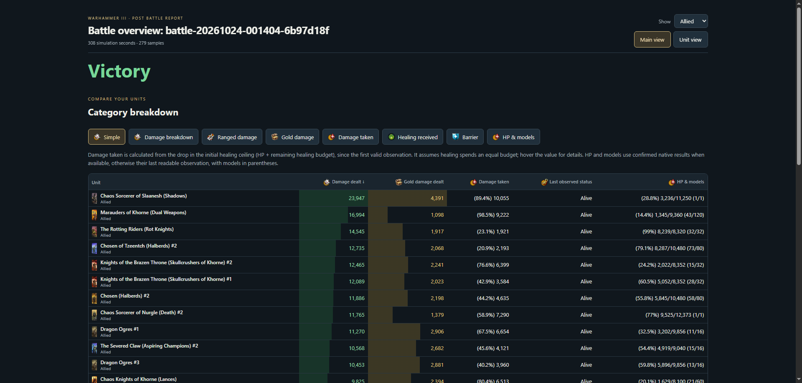
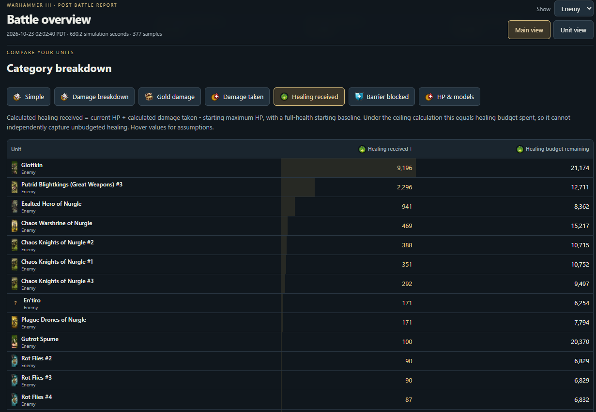
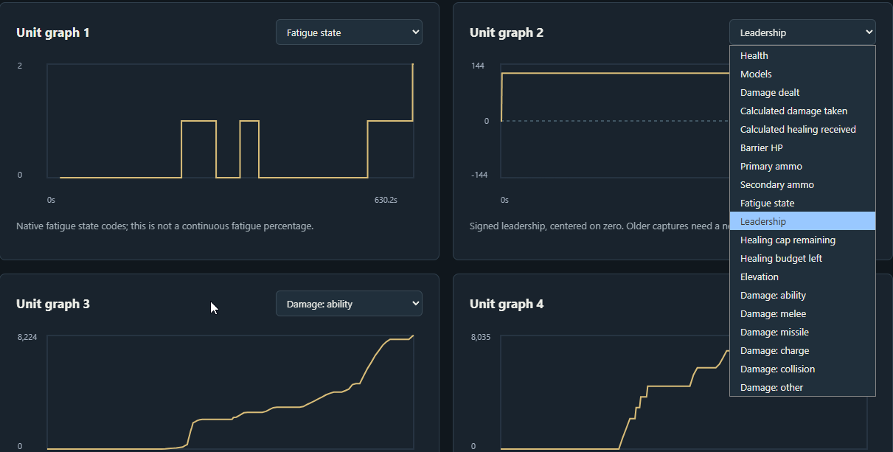
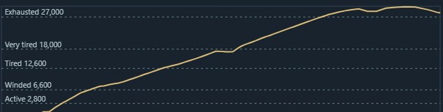
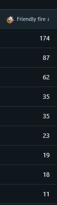

# WARHAMMER III Full Battle Details

An external battle logger for **Total War: WARHAMMER III**. It runs quietly in the Windows notification tray and creates interactive HTML reports after your battles.

Compare unit performance, explore damage breakdowns, and inspect graphs of health, leadership, fatigue, movement and Winds of Magic.

Example output: https://examplebattle.yutaohi.workers.dev/

## Download and run

1. Open the [latest release](https://github.com/Americanyutao/Warhammer-Post-Battle-Logger/releases/latest).
2. Under **Assets**, download the Windows application ZIP. Do not download the **Source code** archives.
3. Right-click the ZIP and choose **Extract All**. Extract it into a folder you can write to.
4. Open the extracted folder and run **WH3BattleLogger.exe**. Keep the **_internal** folder beside the executable.
5. Start the logger before your battle and leave it running through the results screen.

**No application window will appear.** Look for the **LOG** icon in the Windows notification tray, including the hidden icons menu next to the clock.

Right-click the tray icon:

- **Open reports** opens the folder containing your recordings and reports. Open an **HTML** report in your browser.
- **Exit** finishes saving the current recording and closes the logger.

The packaged application does not require Python. It requires **64-bit Windows** and a supported build of **Total War: WARHAMMER III**. Game updates may require an updated logger.

## What the reports show

- **Battle overview:** victory or defeat, with the result classification when captured.
- **Unit comparisons:** damage dealt, gold damage, kills, friendly fire, self damage, calculated damage taken, calculated healing received, HP and models.
- **Damage breakdowns:** melee, missiles and spells, direct damage abilities and effects, plus separate source details.
- **Ranged statistics:** initial primary and secondary ammunition and the net decrease in each ammunition pool.
- **Unit graphs:** health, models, damage, ammunition, fatigue state and points, leadership, healing information and elevation.
- **Movement and occupancy:** sampled paths and time spent in different areas, using a shared map frame for the battle.
- **Winds of Magic:** usable winds and reserves over time.
- **Activity:** time spent in observed activities and states, idle time after rallying, and sampled rally and landing counts.

Choose allied, enemy or all units. Unit graphs can also be opened in separate mini windows, with up to four pop-outs.

## How recording works

The logger reads supported game data from the running game's memory without modifying it. It is an external application rather than a Steam Workshop mod.

Sampling defaults to once per second. Deployment supplies initial unit values, while combat timelines begin when the battle starts. Duration measurements use battle simulation time, so pauses and speed changes do not count as normal-speed elapsed time.

Reports and encrypted recordings are saved in the **captures** folder beside the application:

- **.html:** a standalone report you can open or share without running the logger.
- **.wh3log:** an encrypted battle recording.
- **logger.key:** the private key needed to read your encrypted recordings. Keep it with recordings you want to reopen.

## Interpreting the statistics

Some statistics are sampled observations or calculations rather than complete event histories. Events between samples may be missed.

- **Ammunition:** compares beginning and ending ammunition. Replenishment is not accounted for separately, and dead models take their remaining ammunition with them. The decrease is not a verified count of projectiles fired.
- **Healing and damage taken:** calculated using HP and healing-budget data where available. Healing-cap changes and other capacity changes can affect the calculation. The base healing budget is 75% of maximum HP; healing-cap increases multiply that base. For example, +100% increased healing cap gives 2x75 = 150% of maximum HP as healing budget.
- **Damage categories:** follow the game's recorded source categories. Some spells, including vortex effects, can appear under missiles and spells.
- **Lords and heroes:** the default unit value is 500 gold per level. Treat trade comparisons using that value as estimates.
- **Movement, rallies and landings:** derived from sampled positions and state changes.
- **Barrier statistics:** remain work in progress.

## Screenshots

Compare unit performance in the battle overview, including damage, gold damage, damage taken, status, HP and models.



Explore healing received and the remaining healing budget for each unit.



Select different statistics in the unit graphs to inspect how a battle unfolded.



Follow fatigue points over time against fatigue-state thresholds.



Compare friendly fire across units.



## Build from source

Use Python 3.13 on 64-bit Windows:

```powershell
python -m pip install -r requirements-build.txt
python -B tools/test_ci.py
python -B tools/build_release.py
python -B tools/check_release.py --headless
```

The application is built into `release/WH3BattleLogger/`. Keep the complete folder together. Run `python -B tools/check_release.py` in a normal Windows desktop session for the additional tray checks. `Run-Battle-Logger.cmd` opens the source debugging interface.

GitHub Actions builds a downloadable test artifact on pushes, pull requests and manual runs. Public downloads are distributed through **Releases**; the current workflow does not publish releases automatically.

## Feedback

Report bugs through [Discord](https://discord.gg/v27y7AW7Kz) @Americanyutao
